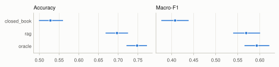
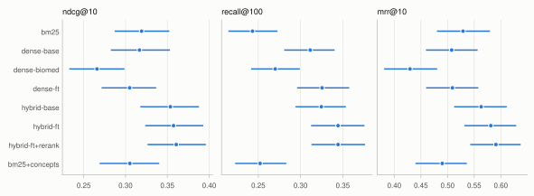
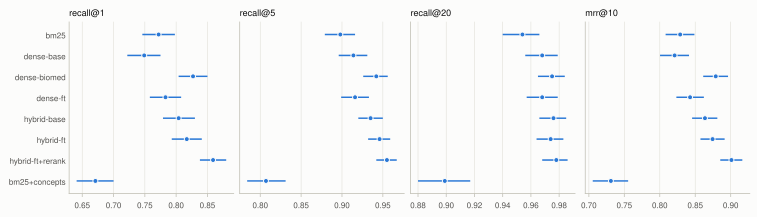
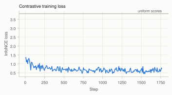
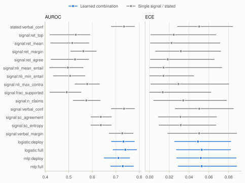
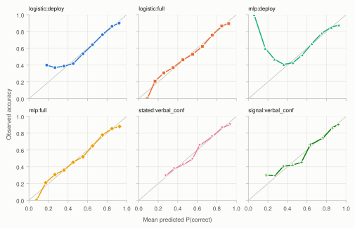
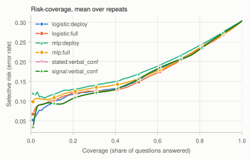
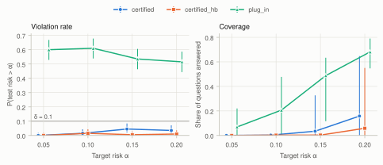
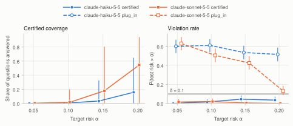

# Results

Generated by `primum exp report` on 2026-11-10T17:42:21+00:00 from the JSON files in `results/`. Every number on this page is read from those files; none is typed by hand. Do not edit this file: re-run the experiments and the report instead.

Intervals are 95%. Their kind differs by quantity and is stated in each section: bootstrap intervals over questions or queries, the central range over repeated random splits, or exact Clopper-Pearson intervals.

Created is the `created` value recorded in each file's `meta`: the time of the run when started from the CLI, or a fixed label when the caller passed one, so it does not order the files in time.

| File | Created | n |
|---|---|---|
| `results/pubmedqa_runs.json` | 2026-11-10T15:24:21+00:00 | 1000 |
| `results/encoder_training.json` | 2026-11-10T13:46:08+00:00 | 57044 |
| `results/rq1_retrieval.json` | 2026-11-10T15:59:40+00:00 | 1323 |
| `results/rq2_confidence.json` | 2026-11-10T15:59:43+00:00 | 1000 |
| `results/rq3_conformal.json` | 2026-11-10T17:16:14+00:00 | 1000 |
| `results/sonnet/pubmedqa_runs.json` | 2026-11-10T17:00:00+00:00 | 1000 |
| `results/sonnet/rq2_confidence.json` | 2026-11-10T17:41:20+00:00 | 996 |
| `results/sonnet/rq3_conformal.json` | 2026-11-10T17:41:20+00:00 | 996 |
| `results/sonnet_sc300/pubmedqa_runs.json` | 2026-11-10T17:00:00+00:00 | 300 |
| `results/sonnet_sc300/rq2_confidence.json` | 2026-11-10T17:41:20+00:00 | 298 |

## PubMedQA benchmark runs

1000 questions; generator `claude-haiku-5-5`, retriever `hybrid-ft` (top 5), 5 samples per `rag` question.

| Condition | n | Failed | Accuracy | Macro-F1 | Supported claims | Gold in evidence |
|---|---|---|---|---|---|---|
| closed_book | 1000 | 0 | 0.528 [0.499, 0.560] | 0.408 [0.377, 0.439] | 0.0% | – |
| rag | 1000 | 0 | 0.697 [0.668, 0.725] | 0.569 [0.540, 0.601] | 31.2% | 94.6% |
| oracle | 1000 | 0 | 0.748 [0.721, 0.773] | 0.593 [0.565, 0.622] | 40.3% | 100.0% |

Accuracy and macro-F1 (yes/no/maybe) with 95% bootstrap intervals over questions.

| Comparison | Pairs | Accuracy difference | p (paired permutation) |
|---|---|---|---|
| rag vs closed book | 1000 | 0.169 [0.135, 0.202] | 1.0e-04 |
| oracle vs rag | 1000 | 0.051 [0.029, 0.073] | 1.0e-04 |

## RQ1: retrieval

### NFCorpus test queries

323 queries.

| System | ndcg@10 | recall@100 | mrr@10 |
|---|---|---|---|
| `bm25` | 0.319 [0.287, 0.352] | 0.243 [0.215, 0.273] | 0.529 [0.480, 0.580] |
| `dense-base` | 0.317 [0.282, 0.353] | 0.311 [0.281, 0.340] | 0.508 [0.459, 0.556] |
| `dense-biomed` | 0.266 [0.233, 0.299] | 0.270 [0.242, 0.299] | 0.430 [0.381, 0.480] |
| `dense-ft` | 0.305 [0.271, 0.337] | 0.325 [0.296, 0.358] | 0.509 [0.460, 0.558] |
| `hybrid-base` | 0.354 [0.318, 0.388] | 0.325 [0.294, 0.354] | 0.563 [0.512, 0.611] |
| `hybrid-ft` | 0.357 [0.324, 0.393] | 0.344 [0.313, 0.376] | 0.581 [0.532, 0.629] |
| `hybrid-ft+rerank` | 0.361 [0.326, 0.396] | 0.344 [0.313, 0.376] | 0.591 [0.543, 0.637] |
| `bm25+concepts` | 0.305 [0.269, 0.340] | 0.252 [0.223, 0.283] | 0.490 [0.440, 0.536] |

Mean over queries with 95% bootstrap intervals over queries.

Difference from `bm25` (paired by query; Holm-adjusted permutation p):

| System | ndcg@10 | recall@100 | mrr@10 |
|---|---|---|---|
| `dense-base` | -0.003 [-0.026, 0.020], p = 0.8276 | 0.068 [0.047, 0.090], p = 0.0007 | -0.021 [-0.058, 0.015], p = 0.4794 |
| `dense-biomed` | -0.053 [-0.077, -0.031], p = 0.0007 | 0.027 [0.007, 0.048], p = 0.0118 | -0.099 [-0.142, -0.060], p = 0.0007 |
| `dense-ft` | -0.014 [-0.041, 0.011], p = 0.5785 | 0.082 [0.056, 0.108], p = 0.0007 | -0.020 [-0.063, 0.025], p = 0.4794 |
| `hybrid-base` | 0.034 [0.021, 0.048], p = 0.0007 | 0.082 [0.064, 0.101], p = 0.0007 | 0.034 [0.011, 0.057], p = 0.0135 |
| `hybrid-ft` | 0.038 [0.022, 0.054], p = 0.0007 | 0.101 [0.082, 0.121], p = 0.0007 | 0.052 [0.024, 0.081], p = 0.0015 |
| `hybrid-ft+rerank` | 0.041 [0.028, 0.057], p = 0.0007 | 0.101 [0.082, 0.122], p = 0.0007 | 0.062 [0.033, 0.093], p = 0.0012 |
| `bm25+concepts` | -0.014 [-0.027, -0.000], p = 0.1038 | 0.009 [0.000, 0.020], p = 0.0761 | -0.039 [-0.064, -0.013], p = 0.0076 |

Difference from `dense-base` (paired by query; Holm-adjusted permutation p):

| System | ndcg@10 | recall@100 | mrr@10 |
|---|---|---|---|
| `bm25` | 0.003 [-0.019, 0.025], p = 0.8270 | -0.068 [-0.091, -0.046], p = 0.0007 | 0.021 [-0.014, 0.058], p = 0.7244 |
| `dense-biomed` | -0.051 [-0.071, -0.030], p = 0.0007 | -0.041 [-0.062, -0.023], p = 0.0007 | -0.078 [-0.113, -0.043], p = 0.0007 |
| `dense-ft` | -0.012 [-0.029, 0.005], p = 0.5315 | 0.014 [-0.004, 0.032], p = 0.1135 | 0.001 [-0.034, 0.037], p = 0.9291 |
| `hybrid-base` | 0.037 [0.021, 0.053], p = 0.0007 | 0.013 [0.004, 0.024], p = 0.0272 | 0.055 [0.028, 0.085], p = 0.0012 |
| `hybrid-ft` | 0.041 [0.023, 0.058], p = 0.0007 | 0.033 [0.016, 0.050], p = 0.0007 | 0.074 [0.043, 0.104], p = 0.0007 |
| `hybrid-ft+rerank` | 0.044 [0.027, 0.063], p = 0.0007 | 0.033 [0.017, 0.050], p = 0.0007 | 0.083 [0.049, 0.116], p = 0.0007 |
| `bm25+concepts` | -0.011 [-0.035, 0.012], p = 0.7053 | -0.059 [-0.081, -0.038], p = 0.0007 | -0.018 [-0.059, 0.024], p = 0.8045 |

### PubMedQA gold-abstract retrieval

1000 queries.

| System | recall@1 | recall@5 | recall@20 | mrr@10 |
|---|---|---|---|---|
| `bm25` | 0.772 [0.746, 0.798] | 0.898 [0.879, 0.916] | 0.954 [0.940, 0.966] | 0.829 [0.808, 0.849] |
| `dense-base` | 0.749 [0.722, 0.775] | 0.914 [0.896, 0.931] | 0.968 [0.956, 0.979] | 0.821 [0.800, 0.841] |
| `dense-biomed` | 0.827 [0.804, 0.850] | 0.942 [0.926, 0.956] | 0.975 [0.965, 0.984] | 0.879 [0.861, 0.896] |
| `dense-ft` | 0.783 [0.758, 0.808] | 0.916 [0.899, 0.933] | 0.968 [0.957, 0.979] | 0.843 [0.823, 0.862] |
| `hybrid-base` | 0.804 [0.779, 0.830] | 0.935 [0.920, 0.950] | 0.976 [0.966, 0.985] | 0.864 [0.846, 0.881] |
| `hybrid-ft` | 0.817 [0.793, 0.841] | 0.946 [0.932, 0.959] | 0.974 [0.964, 0.983] | 0.874 [0.857, 0.891] |
| `hybrid-ft+rerank` | 0.859 [0.838, 0.880] | 0.955 [0.942, 0.967] | 0.978 [0.968, 0.986] | 0.901 [0.885, 0.916] |
| `bm25+concepts` | 0.671 [0.641, 0.700] | 0.807 [0.784, 0.831] | 0.899 [0.880, 0.917] | 0.731 [0.705, 0.755] |

Mean over queries with 95% bootstrap intervals over queries.

Difference from `bm25` (paired by query; Holm-adjusted permutation p):

| System | recall@1 | recall@5 | recall@20 | mrr@10 |
|---|---|---|---|---|
| `dense-base` | -0.023 [-0.050, 0.004], p = 0.2484 | 0.016 [-0.004, 0.036], p = 0.1694 | 0.014 [0.001, 0.028], p = 0.1022 | -0.008 [-0.028, 0.011], p = 0.4503 |
| `dense-biomed` | 0.055 [0.027, 0.082], p = 0.0012 | 0.044 [0.025, 0.064], p = 0.0007 | 0.021 [0.009, 0.034], p = 0.0057 | 0.050 [0.031, 0.071], p = 0.0007 |
| `dense-ft` | 0.011 [-0.017, 0.039], p = 0.4799 | 0.018 [-0.001, 0.037], p = 0.1694 | 0.014 [0.000, 0.027], p = 0.1022 | 0.014 [-0.006, 0.035], p = 0.3764 |
| `hybrid-base` | 0.032 [0.015, 0.050], p = 0.0015 | 0.037 [0.023, 0.052], p = 0.0007 | 0.022 [0.012, 0.033], p = 0.0007 | 0.035 [0.024, 0.047], p = 0.0007 |
| `hybrid-ft` | 0.045 [0.027, 0.062], p = 0.0007 | 0.048 [0.035, 0.062], p = 0.0007 | 0.020 [0.010, 0.031], p = 0.0016 | 0.046 [0.034, 0.058], p = 0.0007 |
| `hybrid-ft+rerank` | 0.087 [0.064, 0.110], p = 0.0007 | 0.057 [0.041, 0.073], p = 0.0007 | 0.024 [0.015, 0.035], p = 0.0007 | 0.072 [0.056, 0.089], p = 0.0007 |
| `bm25+concepts` | -0.101 [-0.124, -0.080], p = 0.0007 | -0.091 [-0.110, -0.074], p = 0.0007 | -0.055 [-0.070, -0.041], p = 0.0007 | -0.098 [-0.116, -0.083], p = 0.0007 |

Difference from `dense-base` (paired by query; Holm-adjusted permutation p):

| System | recall@1 | recall@5 | recall@20 | mrr@10 |
|---|---|---|---|---|
| `bm25` | 0.023 [-0.004, 0.052], p = 0.1225 | -0.016 [-0.035, 0.003], p = 0.2788 | -0.014 [-0.027, 0.000], p = 0.3258 | 0.008 [-0.013, 0.028], p = 0.4421 |
| `dense-biomed` | 0.078 [0.051, 0.105], p = 0.0007 | 0.028 [0.011, 0.044], p = 0.0056 | 0.007 [-0.004, 0.018], p = 0.7574 | 0.058 [0.039, 0.078], p = 0.0007 |
| `dense-ft` | 0.034 [0.011, 0.057], p = 0.0116 | 0.002 [-0.013, 0.017], p = 0.9026 | 0.000 [-0.010, 0.010], p = 1.0000 | 0.022 [0.006, 0.038], p = 0.0122 |
| `hybrid-base` | 0.055 [0.032, 0.080], p = 0.0007 | 0.021 [0.005, 0.036], p = 0.0294 | 0.008 [-0.001, 0.017], p = 0.5467 | 0.043 [0.027, 0.059], p = 0.0007 |
| `hybrid-ft` | 0.068 [0.041, 0.093], p = 0.0007 | 0.032 [0.016, 0.048], p = 0.0015 | 0.006 [-0.003, 0.015], p = 0.7574 | 0.054 [0.036, 0.070], p = 0.0007 |
| `hybrid-ft+rerank` | 0.110 [0.084, 0.136], p = 0.0007 | 0.041 [0.025, 0.058], p = 0.0007 | 0.010 [0.001, 0.019], p = 0.3258 | 0.080 [0.062, 0.098], p = 0.0007 |
| `bm25+concepts` | -0.078 [-0.110, -0.046], p = 0.0007 | -0.107 [-0.131, -0.082], p = 0.0007 | -0.069 [-0.088, -0.050], p = 0.0007 | -0.090 [-0.115, -0.066], p = 0.0007 |

## Encoder fine-tuning

56389 training pairs from 42064 queries, 1763 steps on `mps` in 2060.45 s.

Held-out training-distribution check (500 queries, pool of 651 passages; a sanity check, not a benchmark):

|  | mrr@10 | top1_accuracy |
|---|---|---|
| before | 0.971 | 0.962 |
| after | 0.982 | 0.976 |

## RQ2: confidence signals

1000 `rag` answers (697 correct, accuracy 0.697; 0 failed generations excluded). 200 repeated stratified splits (train / calibration / test = 40% / 30% / 30%). Values are the mean over repeats with the central 95% range of the repeats in brackets.

### All estimators, platt calibration

| Estimator | AUROC | AURC | E-AURC | ECE | Brier |
|---|---|---|---|---|---|
| `stated:verbal_conf` | 0.735 [0.680, 0.781] | 0.167 [0.137, 0.198] | 0.115 [0.085, 0.146] | 0.050 [0.028, 0.084] | 0.181 [0.169, 0.196] |
| `signal:ret_top` | 0.530 [0.418, 0.591] | 0.273 [0.231, 0.340] | 0.221 [0.179, 0.288] | 0.024 [0.001, 0.067] | 0.212 [0.210, 0.216] |
| `signal:ret_mean` | 0.515 [0.422, 0.587] | 0.289 [0.237, 0.357] | 0.237 [0.185, 0.305] | 0.022 [0.001, 0.071] | 0.212 [0.210, 0.216] |
| `signal:ret_margin` | 0.562 [0.507, 0.618] | 0.268 [0.229, 0.310] | 0.216 [0.177, 0.258] | 0.032 [0.006, 0.072] | 0.210 [0.206, 0.216] |
| `signal:ret_agree` | 0.526 [0.423, 0.586] | 0.299 [0.258, 0.364] | 0.247 [0.206, 0.312] | 0.018 [0.001, 0.066] | 0.211 [0.210, 0.216] |
| `signal:nli_mean_entail` | 0.496 [0.417, 0.562] | 0.296 [0.251, 0.344] | 0.244 [0.199, 0.292] | 0.014 [0.000, 0.073] | 0.212 [0.211, 0.215] |
| `signal:nli_min_entail` | 0.506 [0.433, 0.570] | 0.290 [0.248, 0.335] | 0.238 [0.195, 0.283] | 0.014 [0.000, 0.045] | 0.211 [0.210, 0.214] |
| `signal:nli_max_contra` | 0.578 [0.525, 0.632] | 0.244 [0.211, 0.277] | 0.192 [0.159, 0.225] | 0.029 [0.001, 0.080] | 0.209 [0.205, 0.215] |
| `signal:frac_supported` | 0.491 [0.419, 0.553] | 0.305 [0.271, 0.346] | 0.253 [0.219, 0.294] | 0.013 [0.000, 0.062] | 0.212 [0.211, 0.214] |
| `signal:n_claims` | 0.575 [0.518, 0.634] | 0.267 [0.226, 0.308] | 0.214 [0.174, 0.256] | 0.034 [0.004, 0.078] | 0.208 [0.203, 0.216] |
| `signal:verbal_conf` | 0.735 [0.680, 0.781] | 0.167 [0.137, 0.198] | 0.115 [0.085, 0.146] | 0.050 [0.026, 0.085] | 0.180 [0.169, 0.195] |
| `signal:sc_agreement` | 0.637 [0.593, 0.683] | 0.240 [0.218, 0.260] | 0.187 [0.166, 0.208] | 0.031 [0.009, 0.068] | 0.193 [0.181, 0.205] |
| `signal:sc_entropy` | 0.637 [0.593, 0.682] | 0.239 [0.218, 0.260] | 0.187 [0.166, 0.208] | 0.032 [0.009, 0.067] | 0.193 [0.180, 0.205] |
| `signal:verbal_margin` | 0.728 [0.671, 0.775] | 0.169 [0.138, 0.200] | 0.117 [0.086, 0.148] | 0.050 [0.018, 0.088] | 0.183 [0.172, 0.199] |
| `logistic:deploy` | 0.733 [0.681, 0.780] | 0.169 [0.137, 0.206] | 0.117 [0.085, 0.154] | 0.049 [0.025, 0.082] | 0.182 [0.170, 0.197] |
| `logistic:full` | 0.741 [0.688, 0.790] | 0.168 [0.136, 0.205] | 0.116 [0.084, 0.153] | 0.053 [0.027, 0.082] | 0.179 [0.166, 0.195] |
| `mlp:deploy` | 0.711 [0.649, 0.760] | 0.182 [0.148, 0.235] | 0.130 [0.096, 0.183] | 0.052 [0.027, 0.088] | 0.188 [0.176, 0.204] |
| `mlp:full` | 0.730 [0.677, 0.776] | 0.174 [0.139, 0.209] | 0.122 [0.086, 0.157] | 0.053 [0.029, 0.088] | 0.182 [0.169, 0.198] |

### ECE by calibrator

| Estimator | raw | temperature | platt | isotonic |
|---|---|---|---|---|
| `stated:verbal_conf` | 0.058 [0.032, 0.086] | 0.050 [0.025, 0.084] | 0.050 [0.028, 0.084] | 0.054 [0.022, 0.098] |
| `signal:ret_top` | 0.026 [0.001, 0.075] | 0.024 [0.000, 0.066] | 0.024 [0.001, 0.067] | 0.042 [0.007, 0.099] |
| `signal:ret_mean` | 0.026 [0.001, 0.065] | 0.025 [0.000, 0.065] | 0.022 [0.001, 0.071] | 0.041 [0.007, 0.105] |
| `signal:ret_margin` | 0.030 [0.005, 0.069] | 0.029 [0.007, 0.073] | 0.032 [0.006, 0.072] | 0.044 [0.010, 0.097] |
| `signal:ret_agree` | 0.024 [0.001, 0.077] | 0.024 [0.001, 0.073] | 0.018 [0.001, 0.066] | 0.023 [0.001, 0.081] |
| `signal:nli_mean_entail` | 0.026 [0.001, 0.074] | 0.023 [0.000, 0.070] | 0.014 [0.000, 0.073] | 0.036 [0.003, 0.097] |
| `signal:nli_min_entail` | 0.018 [0.001, 0.058] | 0.016 [0.000, 0.061] | 0.014 [0.000, 0.045] | 0.035 [0.003, 0.098] |
| `signal:nli_max_contra` | 0.027 [0.002, 0.082] | 0.028 [0.004, 0.075] | 0.029 [0.001, 0.080] | 0.046 [0.011, 0.092] |
| `signal:frac_supported` | 0.025 [0.001, 0.069] | 0.022 [0.000, 0.067] | 0.013 [0.000, 0.062] | 0.023 [0.000, 0.087] |
| `signal:n_claims` | 0.035 [0.005, 0.076] | 0.037 [0.008, 0.075] | 0.034 [0.004, 0.078] | 0.033 [0.003, 0.075] |
| `signal:verbal_conf` | 0.050 [0.024, 0.077] | 0.050 [0.027, 0.082] | 0.050 [0.026, 0.085] | 0.054 [0.022, 0.098] |
| `signal:sc_agreement` | 0.030 [0.007, 0.062] | 0.032 [0.010, 0.064] | 0.031 [0.009, 0.068] | 0.032 [0.007, 0.070] |
| `signal:sc_entropy` | 0.030 [0.007, 0.059] | 0.032 [0.009, 0.064] | 0.032 [0.009, 0.067] | 0.033 [0.007, 0.073] |
| `signal:verbal_margin` | 0.049 [0.022, 0.084] | 0.050 [0.026, 0.082] | 0.050 [0.018, 0.088] | 0.056 [0.023, 0.099] |
| `logistic:deploy` | 0.052 [0.024, 0.087] | 0.052 [0.025, 0.084] | 0.049 [0.025, 0.082] | 0.058 [0.024, 0.102] |
| `logistic:full` | 0.058 [0.028, 0.097] | 0.056 [0.029, 0.087] | 0.053 [0.027, 0.082] | 0.059 [0.025, 0.104] |
| `mlp:deploy` | 0.060 [0.024, 0.099] | 0.055 [0.027, 0.093] | 0.052 [0.027, 0.088] | 0.056 [0.023, 0.101] |
| `mlp:full` | 0.061 [0.033, 0.094] | 0.057 [0.027, 0.087] | 0.053 [0.029, 0.088] | 0.057 [0.020, 0.106] |

### Feature-group ablation (platt calibration)

| Model | AUROC | AURC | E-AURC | ECE | Brier |
|---|---|---|---|---|---|
| all features | 0.741 [0.688, 0.790] | 0.168 [0.136, 0.205] | 0.116 [0.084, 0.153] | 0.053 [0.027, 0.082] | 0.179 [0.166, 0.195] |
| without retrieval | 0.739 [0.686, 0.788] | 0.165 [0.133, 0.198] | 0.113 [0.081, 0.146] | 0.051 [0.025, 0.086] | 0.180 [0.167, 0.196] |
| without nli | 0.746 [0.691, 0.796] | 0.166 [0.136, 0.198] | 0.114 [0.084, 0.146] | 0.056 [0.030, 0.088] | 0.178 [0.165, 0.195] |
| without verbal | 0.670 [0.623, 0.718] | 0.217 [0.179, 0.252] | 0.164 [0.127, 0.200] | 0.052 [0.023, 0.091] | 0.192 [0.181, 0.204] |
| without self_consistency | 0.732 [0.679, 0.779] | 0.169 [0.138, 0.205] | 0.117 [0.086, 0.153] | 0.049 [0.024, 0.082] | 0.182 [0.170, 0.197] |

Learned models against `stated:verbal_conf` (platt calibration). Brier difference: per-question test loss, 95% bootstrap over questions, paired permutation p. AUROC difference: per repeat.

| Model | Brier difference | p | AUROC difference | Repeats with higher AUROC |
|---|---|---|---|---|
| `logistic:deploy` | 0.001 [-0.002, 0.005] | 0.4070 | -0.002 [-0.034, 0.018] | 46.5% |
| `logistic:full` | -0.002 [-0.007, 0.003] | 0.4156 | 0.006 [-0.029, 0.029] | 70.0% |
| `mlp:deploy` | 0.007 [0.003, 0.011] | 0.0003 | -0.024 [-0.079, 0.015] | 15.5% |
| `mlp:full` | 0.001 [-0.004, 0.006] | 0.6208 | -0.005 [-0.049, 0.030] | 41.0% |

Learned models against `signal:verbal_conf` (platt calibration). Brier difference: per-question test loss, 95% bootstrap over questions, paired permutation p. AUROC difference: per repeat.

| Model | Brier difference | p | AUROC difference | Repeats with higher AUROC |
|---|---|---|---|---|
| `logistic:deploy` | 0.002 [-0.001, 0.005] | 0.3133 | -0.002 [-0.034, 0.018] | 46.5% |
| `logistic:full` | -0.002 [-0.006, 0.003] | 0.5140 | 0.006 [-0.029, 0.029] | 70.0% |
| `mlp:deploy` | 0.007 [0.003, 0.012] | 0.0007 | -0.024 [-0.079, 0.015] | 15.5% |
| `mlp:full` | 0.002 [-0.003, 0.007] | 0.5462 | -0.005 [-0.049, 0.030] | 41.0% |

Best single signal by mean AUROC: `signal:verbal_conf`.

| Estimator | Bins (mean confidence → accuracy, count) |
|---|---|
| `logistic:deploy` | 0.18 → 0.40 (65); 0.27 → 0.37 (892); 0.36 → 0.39 (3125); 0.45 → 0.42 (5499); 0.55 → 0.54 (7561); 0.65 → 0.64 (10005); 0.75 → 0.76 (10583); 0.85 → 0.86 (17220); 0.92 → 0.90 (5050) |
| `logistic:full` | 0.09 → 0.00 (10); 0.17 → 0.21 (346); 0.26 → 0.31 (1707); 0.35 → 0.37 (3264); 0.45 → 0.46 (4745); 0.55 → 0.53 (6354); 0.65 → 0.62 (8788); 0.75 → 0.76 (11814); 0.85 → 0.87 (18315); 0.92 → 0.89 (4657) |
| `mlp:deploy` | 0.06 → 1.00 (2); 0.17 → 0.60 (15); 0.27 → 0.47 (296); 0.36 → 0.41 (1739); 0.46 → 0.43 (5453); 0.55 → 0.52 (9313); 0.65 → 0.66 (11351); 0.75 → 0.78 (12841); 0.85 → 0.85 (14460); 0.93 → 0.88 (4530) |
| `mlp:full` | 0.08 → 0.00 (1); 0.17 → 0.21 (76); 0.27 → 0.31 (766); 0.36 → 0.36 (3114); 0.45 → 0.45 (5851); 0.55 → 0.52 (7202); 0.65 → 0.65 (9504); 0.75 → 0.78 (12138); 0.85 → 0.86 (16032); 0.93 → 0.88 (5316) |
| `stated:verbal_conf` | 0.28 → 0.29 (235); 0.36 → 0.38 (2936); 0.45 → 0.42 (7351); 0.55 → 0.49 (4984); 0.62 → 0.65 (13350); 0.75 → 0.76 (7591); 0.85 → 0.86 (17261); 0.94 → 0.90 (6292) |
| `signal:verbal_conf` | 0.18 → 0.30 (10); 0.27 → 0.29 (709); 0.36 → 0.41 (3989); 0.45 → 0.42 (6353); 0.54 → 0.45 (3534); 0.63 → 0.66 (13908); 0.76 → 0.74 (7334); 0.86 → 0.86 (19503); 0.92 → 0.90 (4660) |

| Estimator | risk at 20% | risk at 40% | risk at 60% | risk at 80% | risk at 100% |
|---|---|---|---|---|---|
| `logistic:deploy` | 0.117 | 0.132 | 0.179 | 0.234 | 0.303 |
| `logistic:full` | 0.120 | 0.128 | 0.172 | 0.232 | 0.303 |
| `mlp:deploy` | 0.130 | 0.149 | 0.189 | 0.241 | 0.303 |
| `mlp:full` | 0.124 | 0.141 | 0.177 | 0.235 | 0.303 |
| `stated:verbal_conf` | 0.107 | 0.130 | 0.182 | 0.231 | 0.303 |
| `signal:verbal_conf` | 0.107 | 0.130 | 0.182 | 0.231 | 0.303 |

## RQ3: certified abstention

1000 `rag` answers, 200 repeated splits, n_cal = 300, δ = 0.1, min_selected = 30 (10% of n_cal). Confidence: `logistic:deploy` with `platt` calibration, both fitted on the training split only.

Guarantee: For new questions drawn i.i.d. from the calibration distribution (PubMedQA expert-labelled questions) and answered by the same pipeline, P(selective risk <= alpha) >= 1 - delta over the draw of the calibration set, under the monotone-risk condition stated in primum.uncertainty.conformal. For the deployed bundle the PubMedQA questions it covers are its held-out rows only; the rest were fitted or certified on. For free-form chat questions the threshold is an operating point, not a guarantee.

Violation rate = share of repeats whose test selective risk exceeds α, with a Clopper-Pearson interval over repeats. Test risk is itself estimated on the test split, so near the boundary this rate overstates the probability that the true risk exceeds α. Coverage and risk: mean over repeats [central 95% range]; risk is averaged over the repeats that answered at least one question.

| Method | α | Violation rate | Coverage | Selective risk | Certified in |
|---|---|---|---|---|---|
| `certified` | 0.05 | 0.0% [0.0%, 1.8%] | 0.000 [0.000, 0.000] | – | 0.0% |
| `certified` | 0.10 | 1.5% [0.3%, 4.3%] | 0.003 [0.000, 0.002] | 0.125 [0.037, 0.261] | 2.5% |
| `certified` | 0.15 | 4.5% [2.1%, 8.4%] | 0.035 [0.000, 0.327] | 0.116 [0.041, 0.196] | 19.0% |
| `certified` | 0.20 | 3.5% [1.4%, 7.1%] | 0.158 [0.000, 0.647] | 0.144 [0.056, 0.211] | 41.0% |
| `certified_hb` | 0.05 | 0.0% [0.0%, 1.8%] | 0.000 [0.000, 0.000] | – | 0.0% |
| `certified_hb` | 0.10 | 1.5% [0.3%, 4.3%] | 0.003 [0.000, 0.002] | 0.125 [0.037, 0.261] | 2.5% |
| `certified_hb` | 0.15 | 0.5% [0.0%, 2.8%] | 0.003 [0.000, 0.003] | 0.116 [0.065, 0.211] | 2.5% |
| `certified_hb` | 0.20 | 1.0% [0.1%, 3.6%] | 0.059 [0.000, 0.550] | 0.136 [0.051, 0.204] | 19.0% |
| `plug_in` | 0.05 | 60.0% [52.9%, 66.8%] | 0.069 [0.000, 0.220] | 0.089 [0.000, 0.262] | 97.5% |
| `plug_in` | 0.10 | 61.0% [53.9%, 67.8%] | 0.207 [0.007, 0.477] | 0.114 [0.000, 0.205] | 99.0% |
| `plug_in` | 0.15 | 53.5% [46.3%, 60.6%] | 0.488 [0.116, 0.633] | 0.151 [0.076, 0.205] | 100.0% |
| `plug_in` | 0.20 | 51.5% [44.3%, 58.6%] | 0.681 [0.547, 0.790] | 0.200 [0.154, 0.247] | 100.0% |

Sensitivity to `min_selected` (certified, binomial):

| Method | α | Violation rate | Coverage | Selective risk | Certified in |
|---|---|---|---|---|---|
| `min_selected=5% of n_cal` | 0.05 | 0.0% [0.0%, 1.8%] | 0.000 [0.000, 0.000] | – | 0.0% |
| `min_selected=5% of n_cal` | 0.10 | 5.0% [2.4%, 9.0%] | 0.008 [0.000, 0.100] | 0.112 [0.015, 0.227] | 9.0% |
| `min_selected=5% of n_cal` | 0.15 | 4.0% [1.7%, 7.7%] | 0.022 [0.000, 0.203] | 0.106 [0.000, 0.199] | 23.0% |
| `min_selected=5% of n_cal` | 0.20 | 1.0% [0.1%, 3.6%] | 0.058 [0.000, 0.560] | 0.121 [0.000, 0.209] | 23.0% |
| `min_selected=10% of n_cal` | 0.05 | 0.0% [0.0%, 1.8%] | 0.000 [0.000, 0.000] | – | 0.0% |
| `min_selected=10% of n_cal` | 0.10 | 1.5% [0.3%, 4.3%] | 0.003 [0.000, 0.002] | 0.125 [0.037, 0.261] | 2.5% |
| `min_selected=10% of n_cal` | 0.15 | 4.5% [2.1%, 8.4%] | 0.035 [0.000, 0.327] | 0.116 [0.041, 0.196] | 19.0% |
| `min_selected=10% of n_cal` | 0.20 | 3.5% [1.4%, 7.1%] | 0.158 [0.000, 0.647] | 0.144 [0.056, 0.211] | 41.0% |
| `min_selected=20% of n_cal` | 0.05 | 0.0% [0.0%, 1.8%] | 0.000 [0.000, 0.000] | – | 0.0% |
| `min_selected=20% of n_cal` | 0.10 | 1.0% [0.1%, 3.6%] | 0.002 [0.000, 0.000] | 0.190 [0.188, 0.193] | 1.0% |
| `min_selected=20% of n_cal` | 0.15 | 7.5% [4.3%, 12.1%] | 0.072 [0.000, 0.457] | 0.131 [0.073, 0.195] | 24.5% |
| `min_selected=20% of n_cal` | 0.20 | 6.0% [3.1%, 10.2%] | 0.283 [0.000, 0.653] | 0.154 [0.067, 0.211] | 61.5% |

Each single signal as the confidence, same certified procedure:

| Method | α | Violation rate | Coverage | Selective risk | Certified in |
|---|---|---|---|---|---|
| `signal:ret_top` | 0.05 | 0.0% [0.0%, 1.8%] | 0.000 [0.000, 0.000] | – | 0.0% |
| `signal:ret_top` | 0.10 | 0.0% [0.0%, 1.8%] | 0.000 [0.000, 0.000] | – | 0.0% |
| `signal:ret_top` | 0.15 | 0.5% [0.0%, 2.8%] | 0.001 [0.000, 0.000] | 0.286 [0.286, 0.286] | 0.5% |
| `signal:ret_top` | 0.20 | 1.5% [0.3%, 4.3%] | 0.002 [0.000, 0.000] | 0.270 [0.230, 0.301] | 1.5% |
| `signal:ret_mean` | 0.05 | 0.0% [0.0%, 1.8%] | 0.000 [0.000, 0.000] | – | 0.0% |
| `signal:ret_mean` | 0.10 | 0.0% [0.0%, 1.8%] | 0.000 [0.000, 0.000] | – | 0.0% |
| `signal:ret_mean` | 0.15 | 0.5% [0.0%, 2.8%] | 0.000 [0.000, 0.000] | 0.316 [0.316, 0.316] | 0.5% |
| `signal:ret_mean` | 0.20 | 0.5% [0.0%, 2.8%] | 0.000 [0.000, 0.000] | 0.292 [0.292, 0.292] | 0.5% |
| `signal:ret_margin` | 0.05 | 0.0% [0.0%, 1.8%] | 0.000 [0.000, 0.000] | – | 0.0% |
| `signal:ret_margin` | 0.10 | 0.0% [0.0%, 1.8%] | 0.000 [0.000, 0.000] | – | 0.0% |
| `signal:ret_margin` | 0.15 | 0.0% [0.0%, 1.8%] | 0.000 [0.000, 0.000] | – | 0.0% |
| `signal:ret_margin` | 0.20 | 0.0% [0.0%, 1.8%] | 0.000 [0.000, 0.000] | – | 0.0% |
| `signal:ret_agree` | 0.05 | 0.0% [0.0%, 1.8%] | 0.000 [0.000, 0.000] | – | 0.0% |
| `signal:ret_agree` | 0.10 | 0.0% [0.0%, 1.8%] | 0.000 [0.000, 0.000] | – | 0.0% |
| `signal:ret_agree` | 0.15 | 0.0% [0.0%, 1.8%] | 0.000 [0.000, 0.000] | – | 0.0% |
| `signal:ret_agree` | 0.20 | 0.0% [0.0%, 1.8%] | 0.000 [0.000, 0.000] | – | 0.0% |
| `signal:nli_mean_entail` | 0.05 | 0.0% [0.0%, 1.8%] | 0.000 [0.000, 0.000] | – | 0.0% |
| `signal:nli_mean_entail` | 0.10 | 0.0% [0.0%, 1.8%] | 0.000 [0.000, 0.000] | – | 0.0% |
| `signal:nli_mean_entail` | 0.15 | 0.0% [0.0%, 1.8%] | 0.000 [0.000, 0.000] | – | 0.0% |
| `signal:nli_mean_entail` | 0.20 | 0.0% [0.0%, 1.8%] | 0.000 [0.000, 0.000] | – | 0.0% |
| `signal:nli_min_entail` | 0.05 | 0.0% [0.0%, 1.8%] | 0.000 [0.000, 0.000] | – | 0.0% |
| `signal:nli_min_entail` | 0.10 | 0.0% [0.0%, 1.8%] | 0.000 [0.000, 0.000] | – | 0.0% |
| `signal:nli_min_entail` | 0.15 | 0.0% [0.0%, 1.8%] | 0.000 [0.000, 0.000] | – | 0.0% |
| `signal:nli_min_entail` | 0.20 | 0.0% [0.0%, 1.8%] | 0.000 [0.000, 0.000] | – | 0.0% |
| `signal:nli_max_contra` | 0.05 | 0.0% [0.0%, 1.8%] | 0.000 [0.000, 0.000] | – | 0.0% |
| `signal:nli_max_contra` | 0.10 | 0.0% [0.0%, 1.8%] | 0.000 [0.000, 0.000] | – | 0.0% |
| `signal:nli_max_contra` | 0.15 | 2.0% [0.5%, 5.0%] | 0.003 [0.000, 0.074] | 0.164 [0.071, 0.241] | 3.0% |
| `signal:nli_max_contra` | 0.20 | 4.5% [2.1%, 8.4%] | 0.015 [0.000, 0.157] | 0.190 [0.068, 0.301] | 11.0% |
| `signal:frac_supported` | 0.05 | 0.0% [0.0%, 1.8%] | 0.000 [0.000, 0.000] | – | 0.0% |
| `signal:frac_supported` | 0.10 | 0.0% [0.0%, 1.8%] | 0.000 [0.000, 0.000] | – | 0.0% |
| `signal:frac_supported` | 0.15 | 0.0% [0.0%, 1.8%] | 0.000 [0.000, 0.000] | – | 0.0% |
| `signal:frac_supported` | 0.20 | 0.0% [0.0%, 1.8%] | 0.000 [0.000, 0.000] | – | 0.0% |
| `signal:n_claims` | 0.05 | 0.0% [0.0%, 1.8%] | 0.000 [0.000, 0.000] | – | 0.0% |
| `signal:n_claims` | 0.10 | 0.0% [0.0%, 1.8%] | 0.000 [0.000, 0.000] | – | 0.0% |
| `signal:n_claims` | 0.15 | 0.0% [0.0%, 1.8%] | 0.000 [0.000, 0.000] | – | 0.0% |
| `signal:n_claims` | 0.20 | 0.0% [0.0%, 1.8%] | 0.000 [0.000, 0.000] | – | 0.0% |
| `signal:verbal_conf` | 0.05 | 0.0% [0.0%, 1.8%] | 0.000 [0.000, 0.000] | – | 0.0% |
| `signal:verbal_conf` | 0.10 | 2.0% [0.5%, 5.0%] | 0.006 [0.000, 0.131] | 0.128 [0.078, 0.203] | 3.5% |
| `signal:verbal_conf` | 0.15 | 5.5% [2.8%, 9.6%] | 0.066 [0.000, 0.427] | 0.119 [0.055, 0.186] | 27.5% |
| `signal:verbal_conf` | 0.20 | 1.5% [0.3%, 4.3%] | 0.320 [0.000, 0.570] | 0.144 [0.042, 0.200] | 72.5% |

Conformal prediction sets over the stated yes/no/maybe probabilities (target coverage 1 − α):

|  | α = 0.05 | α = 0.10 | α = 0.15 | α = 0.20 |
|---|---|---|---|---|
| LAC set coverage | 0.964 [0.920, 0.983] | 0.909 [0.877, 0.943] | 0.898 [0.873, 0.927] | 0.815 [0.773, 0.900] |
| LAC mean set size | 2.421 [2.117, 2.530] | 1.916 [1.760, 2.100] | 1.816 [1.753, 1.890] | 1.489 [1.343, 1.801] |
| LAC empty set rate | 0.000 [0.000, 0.000] | 0.000 [0.000, 0.000] | 0.000 [0.000, 0.000] | 0.000 [0.000, 0.000] |
| APS set coverage | 0.949 [0.913, 0.977] | 0.899 [0.853, 0.937] | 0.852 [0.800, 0.900] | 0.800 [0.757, 0.850] |
| APS mean set size | 2.459 [2.243, 2.660] | 2.060 [1.883, 2.254] | 1.746 [1.550, 1.930] | 1.497 [1.396, 1.640] |
| APS empty set rate | 0.000 [0.000, 0.000] | 0.001 [0.000, 0.003] | 0.004 [0.000, 0.017] | 0.015 [0.000, 0.033] |

Deployment bundle (saved): trained on 400 answers, certified on 300; thresholds α = 0.05: none certified, α = 0.10: 0.875, α = 0.15: 0.849, α = 0.20: 0.736.

## Second generator: Claude Sonnet 5.5

Generator `claude-sonnet-5-5`: 1000 questions, condition(s) `rag`, 1 sample per question, retriever `hybrid-ft` (top 5). The main generator `claude-haiku-5-5` answered 1000 questions with 5 samples per `rag` question, retriever `hybrid-ft` (top 5). Both runs cover the same questions. `claude-sonnet-5-5` was not run in `closed_book` or `oracle`, so there is no such comparison for it. With one sample per question its self-consistency features were not measured; RQ2 leaves them out (listed below). Comparisons between generators on this page are descriptive: each interval describes one run, and no paired test between generators was computed (the RQ3 rows come from two separate sets of repeated splits).

### `rag` benchmark

| Generator | Questions | Samples | n | Failed | Accuracy | Macro-F1 | Supported claims | Gold in evidence |
|---|---|---|---|---|---|---|---|---|
| `claude-haiku-5-5` | all | 5 | 1000 | 0 | 0.697 [0.668, 0.725] | 0.569 [0.540, 0.601] | 31.2% | 94.6% |
| `claude-sonnet-5-5` | all | 1 | 996 | 4 | 0.797 [0.773, 0.821] | 0.677 [0.643, 0.708] | 26.4% | 94.8% |
| `claude-sonnet-5-5` | first 300 (not random) | 5 | 298 | 2 | 0.735 [0.685, 0.785] | 0.638 [0.580, 0.696] | 28.2% | 94.3% |

n counts answered questions (failed generations excluded). Accuracy and macro-F1 with 95% bootstrap intervals over questions, each within its own run.

### RQ2: confidence signals

| Generator | n | Estimator | AUROC | ECE | Brier |
|---|---|---|---|---|---|
| `claude-haiku-5-5` | 1000 | `stated:verbal_conf` | 0.735 [0.680, 0.781] | 0.050 [0.028, 0.084] | 0.181 [0.169, 0.196] |
| `claude-haiku-5-5` | 1000 | `signal:verbal_conf` (best) | 0.735 [0.680, 0.781] | 0.050 [0.026, 0.085] | 0.180 [0.169, 0.195] |
| `claude-haiku-5-5` | 1000 | `logistic:deploy` | 0.733 [0.681, 0.780] | 0.049 [0.025, 0.082] | 0.182 [0.170, 0.197] |
| `claude-sonnet-5-5` | 996 | `stated:verbal_conf` | 0.775 [0.718, 0.830] | 0.044 [0.019, 0.079] | 0.135 [0.124, 0.148] |
| `claude-sonnet-5-5` | 996 | `signal:verbal_conf` (best) | 0.775 [0.718, 0.830] | 0.044 [0.022, 0.071] | 0.135 [0.124, 0.149] |
| `claude-sonnet-5-5` | 996 | `logistic:deploy` | 0.764 [0.700, 0.820] | 0.046 [0.023, 0.081] | 0.136 [0.124, 0.150] |

platt calibration; mean over repeated splits with the central 95% range of the repeats in brackets. Best single signal by mean AUROC is marked (best).

`claude-haiku-5-5` (1000 answers): every feature was measured.

`claude-sonnet-5-5` (996 answers): features not measured and left out: `sc_agreement`, `sc_entropy`; feature sets skipped: `full`.

`claude-sonnet-5-5`: Learned models against `stated:verbal_conf` (platt calibration). Brier difference: per-question test loss, 95% bootstrap over questions, paired permutation p. AUROC difference: per repeat.

| Model | Brier difference | p | AUROC difference | Repeats with higher AUROC |
|---|---|---|---|---|
| `logistic:deploy` | 0.001 [-0.001, 0.003] | 0.1821 | -0.011 [-0.042, 0.012] | 21.0% |
| `mlp:deploy` | 0.003 [-0.000, 0.007] | 0.0635 | -0.022 [-0.083, 0.018] | 15.5% |

### RQ2 on the self-consistency subset

`claude-sonnet-5-5` with 5 samples per question on the first 300 questions in dataset order. This is not a random sample of the full question set. On the 298 questions answered in both `claude-sonnet-5-5` runs, the subset's first-sample decision equals the one-sample run's decision for 298. With several samples per question, a question counts as failed if any of its samples is invalid, so 1 question(s) failed here but were answered in the one-sample run (`17444776`). 298 answers (2 failed generations excluded), accuracy 0.735 against 0.797 for the same generator on all 996 answers; subset numbers need not carry over to the full set.

| Generator | n | Estimator | AUROC | ECE | Brier |
|---|---|---|---|---|---|
| `claude-sonnet-5-5` | 298 | `stated:verbal_conf` | 0.732 [0.628, 0.828] | 0.081 [0.035, 0.138] | 0.171 [0.154, 0.195] |
| `claude-sonnet-5-5` | 298 | `signal:sc_agreement` | 0.605 [0.535, 0.685] | 0.044 [0.008, 0.099] | 0.181 [0.160, 0.204] |
| `claude-sonnet-5-5` | 298 | `signal:sc_entropy` | 0.605 [0.535, 0.685] | 0.043 [0.007, 0.100] | 0.181 [0.160, 0.204] |
| `claude-sonnet-5-5` | 298 | `signal:verbal_margin` (best) | 0.736 [0.637, 0.830] | 0.080 [0.033, 0.140] | 0.170 [0.153, 0.194] |
| `claude-sonnet-5-5` | 298 | `logistic:deploy` | 0.693 [0.593, 0.797] | 0.083 [0.036, 0.149] | 0.179 [0.159, 0.199] |
| `claude-sonnet-5-5` | 298 | `logistic:full` | 0.693 [0.589, 0.793] | 0.086 [0.030, 0.154] | 0.178 [0.157, 0.199] |

`signal:sc_agreement`: mean AUROC 0.605 against 0.732 for `stated:verbal_conf`; `signal:sc_entropy`: mean AUROC 0.605 against 0.732 for `stated:verbal_conf`. These are means over the same repeated splits, set side by side; the paired comparisons in this file are for the learned models:

Learned models against `stated:verbal_conf` (platt calibration). Brier difference: per-question test loss, 95% bootstrap over questions, paired permutation p. AUROC difference: per repeat.

| Model | Brier difference | p | AUROC difference | Repeats with higher AUROC |
|---|---|---|---|---|
| `logistic:deploy` | 0.007 [0.001, 0.014] | 0.0330 | -0.039 [-0.124, 0.035] | 16.0% |
| `logistic:full` | 0.007 [-0.001, 0.013] | 0.0791 | -0.039 [-0.131, 0.034] | 14.5% |
| `mlp:deploy` | 0.012 [0.003, 0.022] | 0.0125 | -0.070 [-0.221, 0.032] | 11.5% |
| `mlp:full` | 0.005 [-0.003, 0.013] | 0.1794 | -0.039 [-0.152, 0.045] | 20.5% |

`claude-sonnet-5-5` (298 answers): every feature was measured.

### RQ3: certified abstention

`claude-haiku-5-5`: 1000 answers, n_cal = 300, δ = 0.1, 200 repeats, confidence `logistic:deploy` (platt). `claude-sonnet-5-5`: 996 answers, n_cal = 299, δ = 0.1, 200 repeats, confidence `logistic:deploy` (platt).

Violation rate (share of repeats with test selective risk above α, Clopper-Pearson interval over repeats):

| α | certified `claude-haiku-5-5` | certified `claude-sonnet-5-5` | plug_in `claude-haiku-5-5` | plug_in `claude-sonnet-5-5` |
|---|---|---|---|---|
| 0.05 | 0.0% [0.0%, 1.8%] | 1.5% [0.3%, 4.3%] | 60.0% [52.9%, 66.8%] | 63.0% [55.9%, 69.7%] |
| 0.10 | 1.5% [0.3%, 4.3%] | 2.0% [0.5%, 5.0%] | 61.0% [53.9%, 67.8%] | 50.5% [43.4%, 57.6%] |
| 0.15 | 4.5% [2.1%, 8.4%] | 0.5% [0.0%, 2.8%] | 53.5% [46.3%, 60.6%] | 42.5% [35.6%, 49.7%] |
| 0.20 | 3.5% [1.4%, 7.1%] | 0.0% [0.0%, 1.8%] | 51.5% [44.3%, 58.6%] | 13.0% [8.7%, 18.5%] |

Certified method: share of repeats that certified a threshold, and coverage (mean over repeats [central 95% range]; when most repeats certify nothing the mean can lie above the range):

| α | certified in `claude-haiku-5-5` | certified in `claude-sonnet-5-5` | coverage `claude-haiku-5-5` | coverage `claude-sonnet-5-5` |
|---|---|---|---|---|
| 0.05 | 0.0% | 2.0% | 0.000 [0.000, 0.000] | 0.003 [0.000, 0.000] |
| 0.10 | 2.5% | 7.0% | 0.003 [0.000, 0.002] | 0.016 [0.000, 0.197] |
| 0.15 | 19.0% | 30.0% | 0.035 [0.000, 0.327] | 0.179 [0.000, 0.805] |
| 0.20 | 41.0% | 61.5% | 0.158 [0.000, 0.647] | 0.544 [0.000, 0.940] |

`signal:verbal_conf` alone as the confidence, same certified procedure:

| α | certified in `claude-haiku-5-5` | certified in `claude-sonnet-5-5` | coverage `claude-haiku-5-5` | coverage `claude-sonnet-5-5` |
|---|---|---|---|---|
| 0.05 | 0.0% | 6.5% | 0.000 [0.000, 0.000] | 0.012 [0.000, 0.185] |
| 0.10 | 3.5% | 34.5% | 0.006 [0.000, 0.131] | 0.117 [0.000, 0.617] |
| 0.15 | 27.5% | 79.0% | 0.066 [0.000, 0.427] | 0.568 [0.000, 0.816] |
| 0.20 | 72.5% | 97.0% | 0.320 [0.000, 0.570] | 0.836 [0.000, 0.903] |

Deployment bundles, one per generator:

- `claude-haiku-5-5` (`artifacts/deployment/claude-haiku-5-5/bundle.json`, saved by this run): trained on 400 answers, certified on 300, 300 held out; thresholds α = 0.05: none certified, α = 0.10: 0.875, α = 0.15: 0.849, α = 0.20: 0.736.
- `claude-sonnet-5-5` (`artifacts/deployment/claude-sonnet-5-5/bundle.json`, saved by this run): trained on 399 answers, certified on 299, 298 held out; thresholds α = 0.05: none certified, α = 0.10: none certified, α = 0.15: 0.732, α = 0.20: 0.581.

